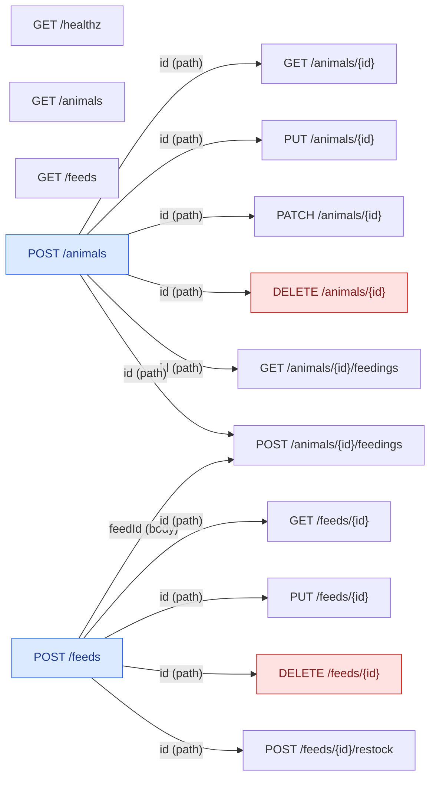

# Zoo dependency graph

The dependency graph of the zoo plan
([`internal/plan/testdata/zoo.plan.json`](../../internal/plan/testdata/zoo.plan.json)).
Each node is an operation. Each arrow goes from the operation that produces
a value to the one that consumes it, labelled with the parameter it fills.
Every arrow into a node is required (AND).

This file is written by hand for now. Once `plan` exists, it should be
generated from the plan file, so it stays in sync as the graph grows.

Blue nodes produce values for others. Red nodes are tagged `destructive`
and run last in the order.

## Order

The `order` from Kahn's algorithm with the `(is DELETE, id)` tie-break:

| # | Operation | Waits for |
|---|---|---|
| 1 | `GET /animals` | — |
| 2 | `GET /feeds` | — |
| 3 | `GET /healthz` | — |
| 4 | `POST /animals` | — |
| 5 | `GET /animals/{id}` | `POST /animals` |
| 6 | `GET /animals/{id}/feedings` | `POST /animals` |
| 7 | `PATCH /animals/{id}` | `POST /animals` |
| 8 | `POST /feeds` | — |
| 9 | `GET /feeds/{id}` | `POST /feeds` |
| 10 | `POST /animals/{id}/feedings` | `POST /animals`, `POST /feeds` |
| 11 | `POST /feeds/{id}/restock` | `POST /feeds` |
| 12 | `PUT /animals/{id}` | `POST /animals` |
| 13 | `PUT /feeds/{id}` | `POST /feeds` |
| 14 | `DELETE /animals/{id}` | `POST /animals` |
| 15 | `DELETE /feeds/{id}` | `POST /feeds` |
